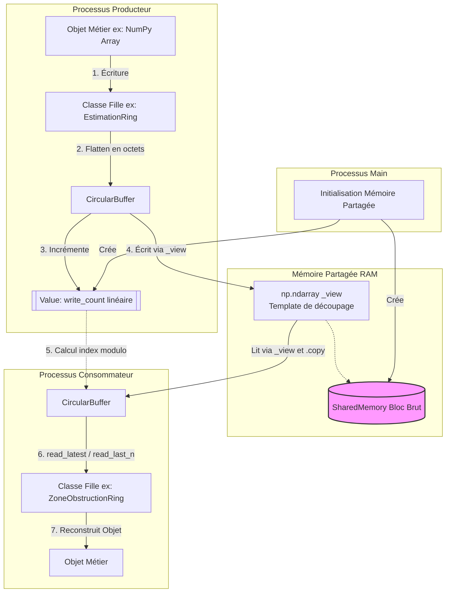

# Documentation d'Architecture : Mémoire Partagée et Circular Buffers
**Projet :** Caméra 2025-2026 (Équipe Mons-Snow) - *Version Refonte*

## 1. Vue d'ensemble (Executive Summary)
Dans le cadre de la refonte logicielle du projet Caméra, l'architecture repose sur un modèle **Multiprocessing**. Les différents traitements (acquisition, estimation, détection d'obstruction) s'exécutent dans des processus systèmes indépendants possédant chacun leur propre espace mémoire. 

Pour assurer une communication inter-processus (IPC) performante et à faible latence, le système implémente un mécanisme de **mémoire partagée** (Shared Memory) structuré sous forme de **Circular Buffers** (ou "Rings" / anneaux de mémoire). 

Le choix du buffer circulaire répond à la nature physique et éphémère des données traitées (télémétrie, flux vidéo) : les données possèdent une "date de péremption" implicite. Une fois la capacité maximale du buffer atteinte, les nouvelles données écrasent automatiquement les plus anciennes, garantissant une empreinte mémoire fixe et un accès constant aux informations les plus récentes.

---

## 2. Architecture et Composants Principaux

L'implémentation repose sur une architecture orientée objet, divisée entre une classe de base agnostique et des classes filles spécialisées.

### 2.1. La classe de base : `CircularBuffer`
Localisée dans `ring.circular_buffer.py`, cette classe gère la logique bas niveau de la mémoire partagée. Elle agit comme une interface sur des blocs d'octets bruts (bytes), sans connaissance de la structure fonctionnelle des données.
Ses paramètres de configuration principaux sont :
*   `name` : Identifiant unique de la mémoire partagée.
*   `capacity` : Nombre de slots (cases) composant le buffer.
*   `item_size` : Taille fixe (en octets) allouée pour chaque slot.
*   `is_creating` : Booléen déterminant le cycle de vie. Si `True`, le processus alloue la mémoire RAM. Si `False`, le processus s'abonne à un espace mémoire déjà existant (bien qu'en pratique, l'instanciation soit centralisée dans le `main`).

### 2.2. Les classes filles (Spécialisation)
Le `CircularBuffer` manipulant des octets bruts, des classes enfants (ex: `FrameRing`, `EstimationRing`, `ZoneObstructionRing`) héritent de la classe de base. 
**Responsabilité :** Elles agissent comme des adaptateurs (wrappers). Elles encapsulent la logique de sérialisation et de désérialisation, permettant aux processus d'écrire et de lire des objets complexes (Dictionnaires, tableaux NumPy, matrices RGB) sans avoir à gérer manuellement leur conversion en `bytes`.

---

## 3. Flux de Données et Interactions

Le flux d'information au sein du buffer suit des règles d'adressage strictes pour garantir la cohérence des données entre producteurs et consommateurs.

### 3.1. Écriture (Producer)
1. **Conversion :** L'objet métier est aplati (reshape) en un tableau d'octets unidimensionnel par la classe fille.
2. **Adressage :** La méthode calcule l'index matériel cible à l'aide d'un modulo : `Index = Compteur d'écriture % Capacité du buffer`.
3. **Écriture :** Les octets sont inscrits dans le slot correspondant du segment de mémoire partagée via un template NumPy (`_view`).
4. **Incrémentation :** Le compteur d'écriture global est incrémenté.

### 3.2. Modes de Lecture (Consumer)
Le système supporte trois stratégies de lecture adaptées à différents besoins :
*   **Lecture Standard (Latest) :** Récupération de la dernière donnée écrite (index d'écriture actuel - 1).
*   **Lecture FIFO (First-In, First-Out) :** Utilise un système de `cursors` identifiés par un `cursor_id`. Chaque processus consommateur maintient son propre état de lecture. Le système calcule le retard (lag). Si le retard dépasse la capacité du buffer, les données non lues sont considérées perdues.
*   **Lecture LIFO N-éléments (`read_last_n`) :** Récupération d'un historique récent (les N dernières valeurs). **Cas d'usage crucial :** Permet la synchronisation de pipelines asynchrones. Si le "chemin A" traite les frames 1, 3, 5 et le "chemin B" traite les frames 2, 6, 10, cette méthode permet de croiser les historiques pour réconcilier les données via leur `frame_id` (timestamp).

---

## 4. Choix Techniques & Points de Vigilance

Cette section détaille les compromis architecturaux et les subtilités d'implémentation critiques pour la stabilité du système.

### 🔴 1 : Le Compteur d'Écriture Linéaire vs Circulaire
Bien que le buffer soit circulaire, **le compteur d'écriture (`write_count`) est strictement linéaire et monotone** (il tend vers l'infini).
*   *Pourquoi ?* Si le compteur était circulaire (ex: 0 à 9, puis retour à 0), un processus lisant le slot 6 à l'instant *T*, puis relisant le slot 6 à l'instant *T+1*, serait incapable de déterminer s'il s'agit de la même donnée, ou si le buffer a fait un tour complet et a écrasé la donnée. L'échelle linéaire lève cette ambiguïté de manière univoque.

### 🔴 2 : Sérialisation (Pickling) et le bug du `_view`
Pour segmenter l'espace brut en slots, la classe utilise un gabarit NumPy stocké dans `self._view`. 
*   *Le Problème :* Lors de la transmission de l'objet `CircularBuffer` entre processus (via Pickle), le `np.ndarray` (`_view`) "gèle" son état. Dans le processus enfant, la vue pointe vers des données statiques historiques au lieu de pointer vers la mémoire partagée en temps réel (générant des lectures vides ou obsolètes).
*   *La Solution :* Surcharge des méthodes de sérialisation. Lors du transfert (`__getstate__`), l'attribut `_view` est supprimé de l'objet. À la réception dans le processus enfant (`__setstate__`), le `_view` est recréé dynamiquement pour s'arrimer correctement au véritable espace mémoire partagé. **Ne pas modifier cette mécanique sous peine de briser l'IPC.**

### 🔴 3 : Prévention des conditions de course (Race Conditions)
Lors de la lecture d'un slot, la donnée est immédiatement clonée via `.copy()`. Ceci fige l'état de la donnée lue dans la RAM locale du processus consommateur, évitant qu'elle ne soit altérée en cours d'utilisation si le producteur effectue une rotation complète du buffer et commence à écraser ce même slot.

---

## 5. Diagramme d'Architecture (Annexe)

Le diagramme suivant illustre la mécanique d'accès à la mémoire partagée entre deux processus via l'héritage des classes.

Note : Ce document a été généré par IA (Gemini Pro Extended), corrigé par Yvann, basé sur cette vidéo : https://youtu.be/Df025d4Wbz4
