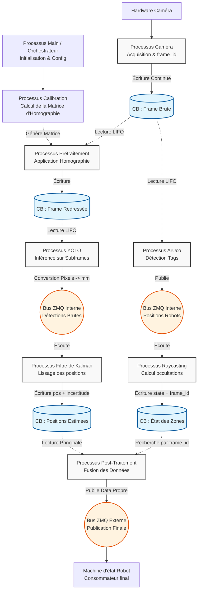

# Documentation d’Architecture : Système de Vision Caméra (Édition 2025-2026)

## 1. Vue d'ensemble (Executive Summary)

Le module de vision par ordinateur (Caméra) du robot a été entièrement repensé pour la saison 2025-2026. L'objectif de cette refonte est d'abandonner l'ancienne approche monolithique au profit d'une **architecture modulaire, performante et hautement concurrente**. 

Ce système est chargé d'acquérir les flux vidéo en temps réel, de détecter les robots (tags ArUco), de localiser les éléments de jeu (Jengas) via inférence GPU (YOLO), et de déterminer l'état d'obstruction des zones d'intérêt. Pour contourner les limitations du GIL (Global Interpreter Lock) de Python, l'architecture repose sur le **Multiprocessing**. Les différents processus sont strictement indépendants et communiquent de manière asynchrone via des segments de mémoire partagée (Circular Buffers) pour les flux lourds, et des bus de messages (ZeroMQ) pour les données légères.

## 2. Architecture et Composants Principaux

Le système est orchestré par un point d'entrée unique (`main.py`) qui se charge de la configuration (fichier `.yaml`), de l'allocation mémoire et de l'instanciation des processus. 

Les composants se divisent en plusieurs processus de traitement (Workers) :

*   **Processus d'Acquisition (Caméra) :** Gère l'interface avec le hardware. Il capture les images à haute fréquence et leur assigne un identifiant unique absolu (`frame_id`). Gère aussi le fait de faire fonctionner le pipeline sur une vidéo. 
*   **Processus de Calibration :** S'exécute à l'initialisation. Il acquiert 100 frames pour détecter les tags de référence du terrain et générer la **matrice d'homographie** (nécessaire pour la projection 3D vers 2D).
*   **Processus de Détection ArUco :** Analyse l'image brute pour extraire la position globale (X, Y, Theta) des robots sur la table.
*   **Processus de Raycasting :** Utilise la position des robots pour modéliser les lignes de vue et déterminer quelles zones de jeu sont masquées (occultation).
*   **Processus de Prétraitement (Homographie) :** Applique la matrice de calibration sur l'image brute pour produire une image "redressée" (vue de dessus parfaite), facilitant les calculs métriques.
*   **Processus YOLO (Inférence GPU) :** Détecte les éléments de jeu (Jengas). Pour maximiser les performances, il n'analyse que des sous-régions de l'image (Subframes) correspondant aux zones d'intérêt.
*   **Processus Filtre de Kalman :** Lisse les détections brutes de YOLO pour éliminer le bruit de mesure et obtenir une précision sub-millimétrique.
*   **Processus de Post-Traitement (Fusion) :** Le nœud final. Il réconcilie les données spatiales et temporelles de tous les autres processus pour produire le "Single Source of Truth" envoyé au robot principal.

## 3. Flux de Données et Interactions

La force de cette architecture réside dans son asynchronisme. Une fois l'image capturée, le traitement se divise en **deux chemins parallèles** qui fusionnent à la fin.

### Étape A : Acquisition et Stockage
Le processus Caméra écrit chaque nouvelle frame dans un buffer circulaire en mémoire partagée (`CB Frame brute`). Chaque frame est horodatée et estampillée d'un `frame_id`.

### Étape B : Séparation des flux (Pipeline Parallèle)

**Chemin 1 : Localisation Globale & Visibilité**
1.  **ArUco** lit la dernière frame brute (LIFO), détecte les robots et publie leurs positions sur un bus ZMQ interne.
2.  **Raycasting** lit ces positions sur le bus ZMQ, calcule les occultations, et écrit l'état de visibilité de chaque zone (associé au `frame_id`) dans un buffer circulaire (`CB État des zones`).

**Chemin 2 : Détection des Éléments de Jeu**
1.  **Prétraitement** lit la frame brute, applique l'homographie, et écrit l'image corrigée dans le buffer `CB Frame redressée`.
2.  **YOLO** lit l'image redressée, découpe 5 "Subframes" (zones de ramassage/dépôt), effectue l'inférence, convertit les pixels en coordonnées globales (mm), et publie les résultats sur un bus ZMQ interne.
3.  **Filtre de Kalman** écoute ces détections, met à jour son modèle prédictif pour chaque objet, et écrit la position estimée (avec son incertitude et le `frame_id`) dans le buffer `CB Positions estimées`.

### Étape C : Synchronisation et Publication externe
Le processus de **Post-Traitement** lit le `CB Positions estimées`. Il extrait le `frame_id` du résultat de Kalman et va chercher l'état de visibilité correspondant exactement à ce même `frame_id` dans le `CB État des zones`. 
Une fois les données corrélées temporellement, il assigne les objets aux zones (couleurs, disposition), écarte les zones occultées, et publie le résultat final, propre et formaté, sur le **bus ZMQ Externe** à destination de la machine d'état du robot.

## 4. Choix Techniques & Points de Vigilance

Cette section détaille les décisions d'ingénierie et les pièges à éviter lors de la maintenance du code :

*   **Multiprocessing vs Multithreading :** L'analyse d'image est "CPU-bound". Utiliser des threads en Python aurait provoqué un goulot d'étranglement à cause du GIL. Le choix s'est porté sur des processus distincts. *Attention : Cela implique que la mémoire ne se partage pas nativement.* Toute nouvelle donnée lourde doit passer par un objet `multiprocessing.Array` ou assimilé encapsulé dans nos `CircularBuffer`.
*   **Tampons Circulaires en mode LIFO (Last-In, First-Out) :** Le système opère en temps réel. Si un processus (ex: YOLO) est plus lent que la caméra, il ne doit *pas* traiter son retard, mais sauter des frames pour prendre l'image la plus récente. C'est le comportement attendu des buffers mis en place.
*   **Topologie Producteur/Consommateurs multiples :** La règle d'or de l'architecture mémoire du projet est : **1 Buffer = 1 seul Processus auteur (Write) / N Processus lecteurs (Read)**. Ne jamais tenter de faire écrire deux processus dans le même buffer.
*   **Optimisation par Subframes (YOLO) :** L'inférence sur des images 1080p ou 4K sature le GPU inutilement. La règle de gestion appliquée est stricte : "Tout ce qui est hors des zones de dépôt ou de ramassage est ignoré". Le découpage en 5 subframes réduit drastiquement le coût de calcul.
*   **L'importance cruciale du `frame_id` :** Les chemins ne vont pas à la même vitesse. Les flux se désynchronisent naturellement. Le `frame_id` est la clé primaire qui permet au Post-Traitement d'aligner une position d'objet avec l'état visuel exact de la table au moment où la photo a été prise. *Ne cassez jamais la propagation du `frame_id` dans les structures de données.*
*   **Hypothèse Statique du Filtre de Kalman :** Le modèle mathématique du filtre part du principe physique que les éléments de jeu (Jengas) sont immobiles sur la table. Le filtre est calibré pour lisser le "bruit" de la caméra, pas pour tracker des objets en mouvement rapide. 

---

## 5. Diagramme d'Architecture (Mermaid)

Note : ce document a été généré par IA (Gemini Pro Extended) le 21/09/2026 à partir de la vidéo disponible ici : 
https://youtu.be/vWK8W6CELmY
